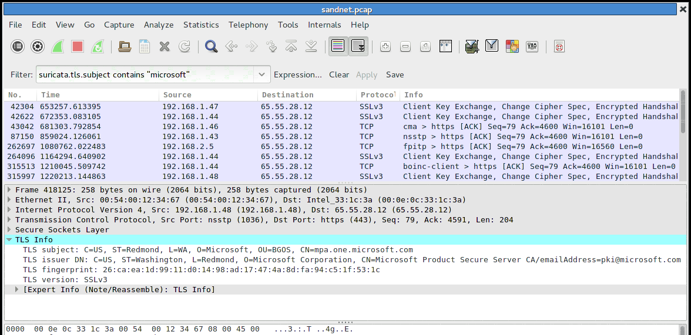

========
Suriwire
========

Introduction
============

Suriwire is a plugin for wireshark that allow you to display
suricata alert and protocol information as element of the
protocol dissection.

Suriwire has parsing for the following events:

* Alerts
* HTTP
* fileinfo
* TLS
* SSH
* SMB

For example, the preceding screenshot shows how it is possible to search for
TLS session where the subject of the certificate matches a certain string.

Installation
============

Suriwire needs a wireshark built with Lua support and a Lua JSON library.

Plugin
------

Copy or link ``suriwire.lua`` to your personal Lua plugins directory: ::

 mkdir -p ~/.local/lib/wireshark/plugins
 ln -s $PWD/suriwire.lua ~/.local/lib/wireshark/plugins/

The directory is ``~/.local/lib/wireshark/plugins`` on Linux and macOS and
``%APPDATA%\Wireshark\plugins`` on Windows. The exact path used by your
installation is listed as ``Personal Lua Plugins`` in
``Help->About Wireshark->Folders`` (or in the output of ``tshark -G folders``).

JSON library
------------

Suriwire uses the ``cjson`` library with a fallback on ``dkjson``. The library
must be visible from the Lua interpreter embedded in wireshark, so it has to
match its Lua version (5.3 or 5.4 since wireshark 4.4, 5.1 or 5.2 before,
see ``Help->About Wireshark``). If none is found, wireshark displays a
``module 'dkjson' not found`` error at startup.

The simplest method, which works on all systems, is to copy ``dkjson.lua``
(a single pure Lua file available from http://dkolf.de/dkjson-lua/) next to
``suriwire.lua`` in the plugins directory.

Alternatively, install the library with your distribution packages
(``lua-cjson`` or ``lua-dkjson``) or with luarocks. If it ends up in a place
which is not in the search path of wireshark, use the standard ``LUA_PATH``
(for ``dkjson``) or ``LUA_CPATH`` (for ``cjson``) environment variables: ::

 LUA_PATH="/path/to/share/lua/5.4/?.lua;;" wireshark sample.pcap
 LUA_CPATH="/path/to/lib/lua/5.4/?.so;;" wireshark sample.pcap

Usage
=====

Run externally suricata on the pcap file you study to create a
suitable alert file. You need to use the ``EVE`` output format.
To specify a directory to output files to, you can use the ``-l``
flag in suricata ::

 suricata -r sample.pcap -l log/

Then you will be able to use the ``log/eve.json`` file.

In wireshark, open the pcap file and go to ``Tools->Suricata->Activate``.
Then enter the name of the EVE file. This will parse again the file adding
all Suricata generated information.

You can also indicate which EVE file to parse at start by running something
like: ::

 SURIWIRE_EVE_FILE=log2/eve.json wireshark sample.pcap

You will now find information about the alerts and other events:

* In the detail of a packet under ``Suricata analysis`` element
* In ``Analyse->Expert Info Composite``

You can also filter on the ``suricata`` protocol. The protocol has
fields like ``suricata.alert.sid`` and ``suricata.tls.subject`` which can be used
in filter.

If you reuse the same ``eve.json`` file, you can set the default path in the
protocol preferences inside wireshark.

More information on https://home.regit.org/software/suriwire.
